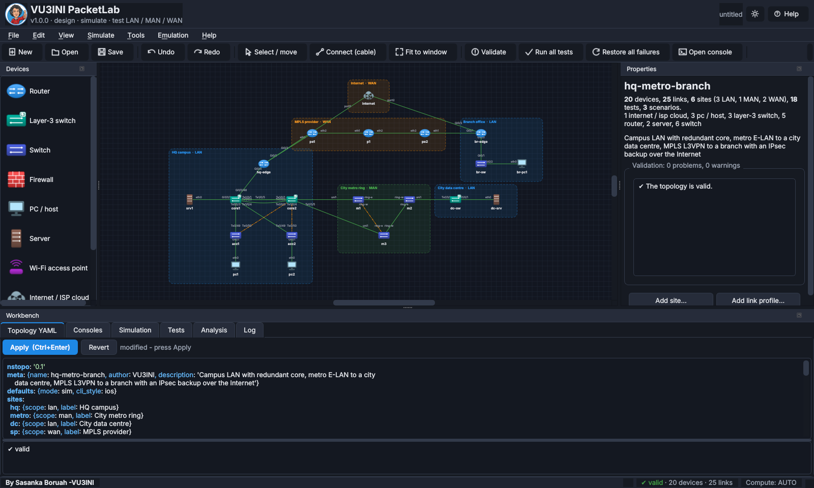
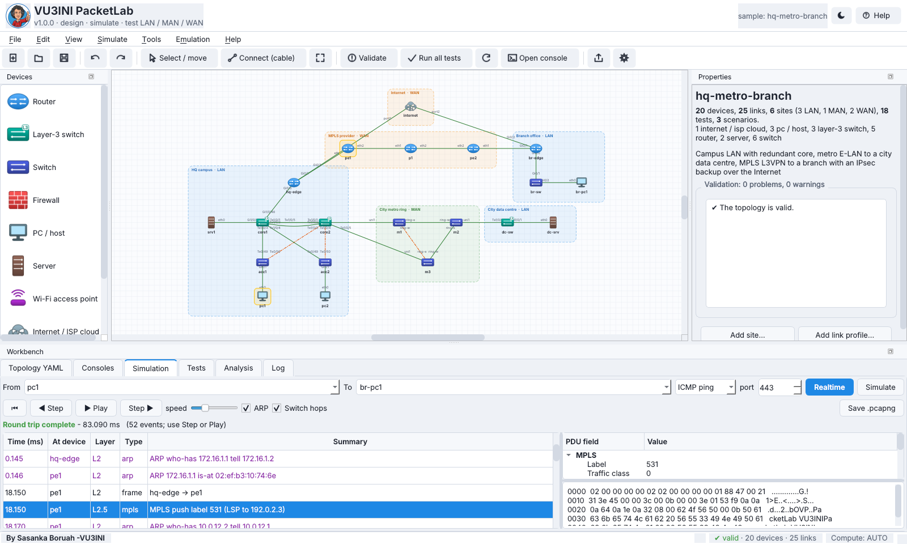
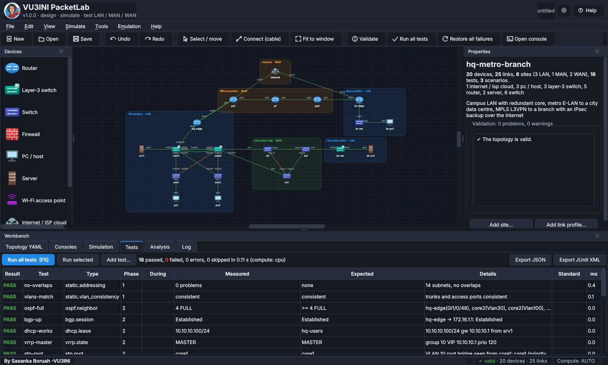

<p align="center"></p>

<h1 align="center">VU3INI PacketLab</h1>
<p align="center"><b>Design, simulate and test LAN, MAN and WAN networks to current industry standards — fully offline on Windows 10/11.</b><br>
By Sasanka Boruah – VU3INI · hamvu3ini@gmail.com</p>



## Download

Get **`VU3INI_PacketLab_Installer_v1.0.0.zip`** from the **[Releases page](../../releases/latest)**. Extract it and run `VU3INI_PacketLab_Setup_v1.0.0.exe`.
No admin rights or Internet are needed. The NVIDIA GPU add-on is included and optional.

**Full instructions are in the [User Guide](USER_GUIDE.md).**

## What it does

- **Design** with routers, Layer-3 switches, switches, firewalls, PCs, servers, Wi-Fi APs and an Internet cloud. Sites are grouped as LAN / MAN / WAN zones.
- **Simulate** 802.1Q VLANs and trunks, per-VLAN RSTP, LACP, G.8032 metro rings, OSPF, IS-IS, BGP, MPLS LDP, VRRP, DHCP with relay, DNS, NAT, ACLs and IPsec tunnels.
- **Realtime and Simulation modes**, Packet Tracer style: step through every ARP, frame, MPLS label and NAT translation. A PDU inspector with hex dump, packet animation and **.pcapng export for Wireshark**.
- **Cisco IOS-style CLI** on every device (abbreviations, history, Tab completion) and a Windows-style prompt on PCs.
- **Automated tests**: addressing, VLANs, OSPF/BGP state, DHCP, DNS, ACLs, failover time *during* failure scenarios, **RFC 2544** throughput, **ITU-T Y.1564** service activation and **TWAMP** delay/jitter. Results export to JSON and JUnit.
- **CPU, NVIDIA GPU or both**, with automatic CPU fallback if the GPU runs out of memory.
- **Export to Containerlab or Kathará** with FRRouting configs and tc-netem link impairments, and deploy through WSL2 or SSH to run on real router software.
- Dark/light themes, searchable Help, a Settings window with 80 options, and four sample labs including a troubleshooting exercise.

| Simulation mode | Automated tests |
|---|---|
|  |  |

## Build it yourself

See **[BUILDING.md](BUILDING.md)**. Run `BUILD.bat` on Windows with Python 3.11–3.14. It runs the 46 functional tests, freezes the app with PyInstaller, and writes a versioned installer zip to `release/`.
The offline wheel bundle (`wheels/`) is not stored in this repository. Without it, the build downloads the packages from PyPI once.

## Repository layout

```
app/packetlab/core     simulation engine, CLI, test runner, exporters, compute backend
app/packetlab/gui      PySide6 desktop interface
app/packetlab/samples  sample labs (*.nstopo.yaml)
installer/             setup wizard and uninstaller
tests/                 functional test suite
build.py, BUILD.bat    one-click Windows build
```

## Credits and licence

PacketLab is built with Python, Qt/PySide6, NumPy, PyYAML and PyInstaller (plus optional CuPy and NVIDIA CUDA). Its design was inspired by Cisco Packet Tracer, GNS3, Containerlab, Kathará, CORE, Mininet, netlab, Batfish, Filius and several open-source simulators credited in **Help › About**.

**Personal use only.** Use of the software is governed by its **[Terms of Use](TERMS_OF_USE.html)**. Product names such as Cisco, Packet Tracer, Juniper and Wireshark are trademarks of their owners; this project is not affiliated with them.
