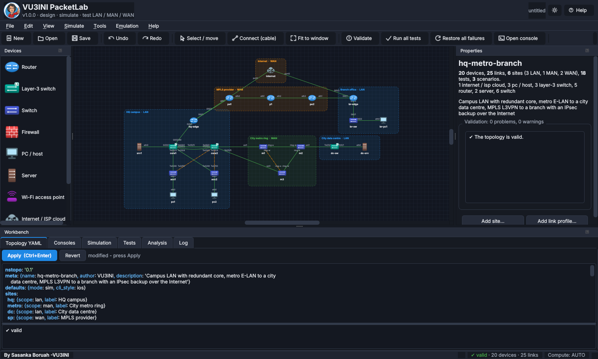
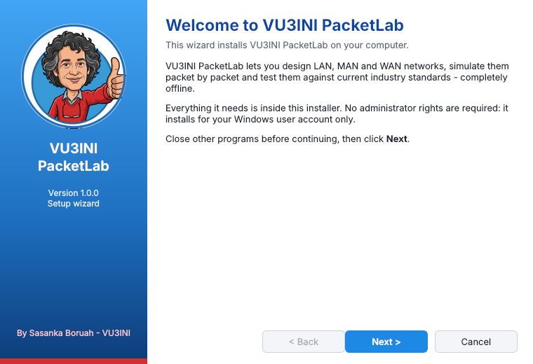
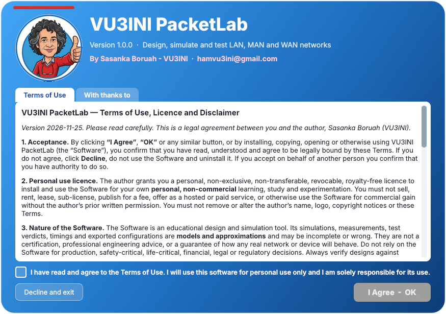
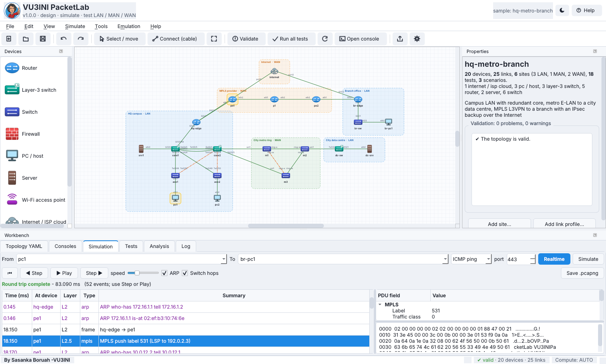
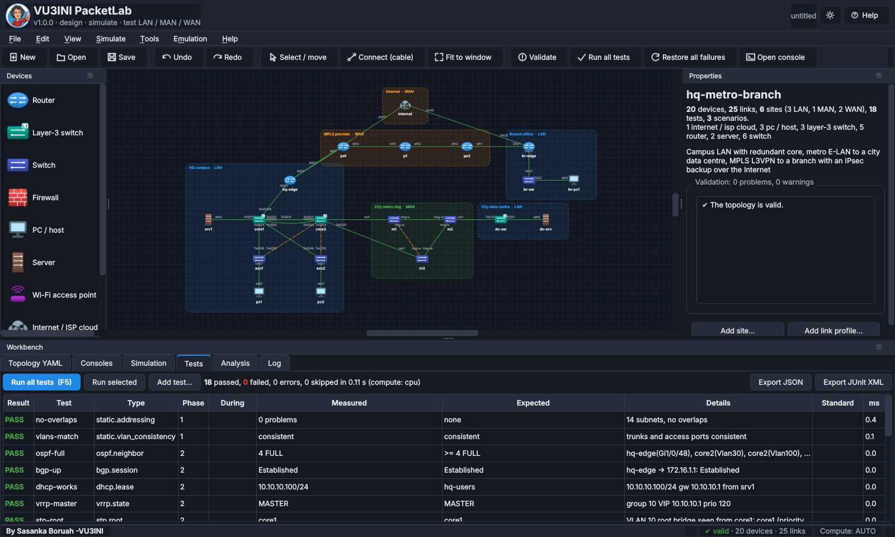

# VU3INI PacketLab — User Guide

**Version 1.0.0** · By Sasanka Boruah – VU3INI · hamvu3ini@gmail.com

VU3INI PacketLab is a Windows 10/11 desktop application for designing **LAN, MAN and WAN** networks, simulating them packet by packet, and testing them against current industry standards. Examples include IEEE 802.1Q / 802.1w, OSPF RFC 2328, BGP RFC 4271, VRRP RFC 5798, ITU-T G.8032 and Y.1564, and RFC 2544. It works completely offline. Think of it as a Packet Tracer-style lab that also runs automated tests and can export your design to real router software.



---

## Contents
1. [Install](#1-install)
2. [First start: Terms of Use](#2-first-start-terms-of-use)
3. [A tour of the window](#3-a-tour-of-the-window)
4. [Your first network in 10 minutes](#4-your-first-network-in-10-minutes)
5. [Configuring devices](#5-configuring-devices)
6. [Device consoles (CLI)](#6-device-consoles-cli)
7. [Realtime and Simulation modes](#7-realtime-and-simulation-modes)
8. [Failure testing and scenarios](#8-failure-testing-and-scenarios)
9. [Automated tests](#9-automated-tests)
10. [The topology file (YAML)](#10-the-topology-file-yaml)
11. [Analysis and GPU/CPU computing](#11-analysis-and-gpucpu-computing)
12. [Exporting and emulation on real router software](#12-exporting-and-emulation-on-real-router-software)
13. [Sample labs](#13-sample-labs)
14. [Settings](#14-settings)
15. [Keyboard shortcuts](#15-keyboard-shortcuts)
16. [Troubleshooting](#16-troubleshooting)
17. [Uninstall](#17-uninstall)
18. [Limitations](#18-limitations)

---

## 1. Install

1. Download **`VU3INI_PacketLab_Installer_v1.0.0.zip`** from the [Releases page](../../releases).
2. Right-click the zip and choose **Extract All…**. Keep the `data` folder next to the Setup program.
3. Double-click **`VU3INI_PacketLab_Setup_v1.0.0.exe`**.
4. Follow the wizard: **Welcome → Terms of Use** (accept to continue) **→ Install location → Options → Ready → Installing → Finish**.



The **Options** page offers:
- Start-menu shortcuts (Program + Uninstall)
- A desktop shortcut
- Adding PacketLab to "Open with" for `.yaml` topology files
- The **NVIDIA GPU add-on** (CuPy + CUDA 12, included offline). Leave it ticked if you have an NVIDIA card.

No administrator rights are needed. PacketLab installs for your Windows user only, in `%LOCALAPPDATA%\Programs\VU3INI PacketLab`.

> **SmartScreen:** if Windows says *"Windows protected your PC"*, click **More info → Run anyway**. The program is not code-signed with a paid certificate.

**Upgrading:** run a newer Setup. It replaces the program and keeps your settings and saved networks.

---

## 2. First start: Terms of Use

The rounded splash screen shows the **Terms of Use** and a **"With thanks to"** tab that credits the creators of every library, tool and standard used.



Tick **"I have read and agree…"** and click **I Agree – OK**. The splash closes only through OK. **Decline and exit** closes the application. You can turn the splash off later in Settings › General once you have accepted the terms.

---

## 3. A tour of the window

| Area | What it does |
|---|---|
| **Top left** | VU3INI logo, app name and version |
| **Top right** | File name, **☀/☾ theme toggle** (dark/light) and **Help** |
| **Menu and toolbar** | File, Edit, View, Simulate, Tools, Emulation, Help; quick buttons for New/Open/Save, Undo/Redo, Select, **Connect**, Fit, **Validate**, **Run all tests**, Restore failures, Console, Export, Settings |
| **Left: Devices** | Router, Layer-3 switch, Switch, Firewall, PC/host, Server, Wi-Fi AP, Internet/ISP cloud, External network |
| **Centre: Canvas** | Your network. Coloured zones are sites: **blue = LAN, green = MAN, orange = WAN** |
| **Right: Properties** | Settings of the selected device or link. With nothing selected it shows a summary and validation problems |
| **Bottom: Workbench** | Tabs: **Topology YAML, Consoles, Simulation, Tests, Analysis, Log** |
| **Bottom left** | Footer "By Sasanka Boruah -VU3INI" |
| **Bottom right** | Validation status, number of simulated failures, compute device |

**Link colours on the canvas**

| Look | Meaning |
|---|---|
| Solid green | Link up and forwarding |
| Dashed orange | Blocked by spanning tree (alternate port), or the G.8032 ring protection link |
| Dashed red | Link down (failed or shut down) |
| A red cross over a device | Device powered off |

Panels can be moved, floated or hidden (View menu). **View › Reset window layout** puts them back.

---

## 4. Your first network in 10 minutes

We'll build a small office: one router, one switch, two PCs, DHCP and the Internet.

1. **File › New** (Ctrl+N).
2. Drag a **Router**, a **Switch**, two **PC / host** devices and an **Internet / ISP cloud** onto the canvas. They are named R1, SW1, PC1, PC2 and Cloud1.
3. Press **C** (Connect mode). Click **PC1**, choose `eth0`, then click **SW1** and choose a new port (`Gi0/1`). Repeat for PC2 → SW1 (`Gi0/2`), SW1 (`Gi0/3`) → R1 (`Gi0/0`), and R1 (`Gi0/1`) → Cloud1. Press **Esc** to finish.
4. Select **R1**. In **Properties › Interfaces**, set `Gi0/0` IPv4 to `192.168.1.1/24` and `Gi0/1` to `203.0.113.2/30`.
5. Define an address pool. In the **Topology YAML** tab, add this line under `addressing:` and press **Ctrl+Enter**:
   ```yaml
     office: { ipv4: 192.168.1.0/24, purpose: lan }
   ```
   Then select **R1**. In **Properties › Advanced (YAML of this device)**, add these two lines and click **Apply device YAML**:
   ```yaml
   services: { dhcp: { pools: [office] } }
   policies: { nat: { inside: [Gi0/0], outside: Gi0/1, overload: true } }
   ```
6. PCs are DHCP clients by default. Double-click **PC1** and type `ipconfig`. It shows `192.168.1.100` with gateway `192.168.1.1`.
7. Type `ping Cloud1`. You get replies through NAT.
8. **File › Save** (Ctrl+S). Your network is saved as `*.nstopo.yaml`.

---

## 5. Configuring devices

Select a device to edit it in **Properties**:

- **Name, Kind, Site** (or *New site…*), **Role, Run mode** (sim / emu / hybrid) and **CLI style** (IOS / Junos / FRR).
- **Switches:** STP priority (set your core to 4096 so it becomes the root), and the VLAN list as `10:users, 20:voice`.
- **Interfaces table:** mode (access / trunk / routed), IPv4 (`10.0.0.1/24`, `auto` or `dhcp`), access VLAN, allowed VLANs on trunks, default gateway (hosts), and a Shutdown tick-box. Use **Add interface** for SVIs (`Vlan10`), loopbacks (`Lo0`) or extra ports.
- **Advanced (YAML of this device):** anything not in the form, such as routing protocols, VRRP, ACLs, tunnels and services. Click **Apply device YAML**.

Select a **link** to set its **profile** (bandwidth, delay, jitter, loss), **type** (copper, fibre, WAN circuit, wireless, serial), **length in km** (adds 5 µs per km of fibre), a **label**, or to bring it down or up.

With nothing selected, use **Add site…** (choose LAN / MAN / WAN) and **Add link profile…**.

**What PacketLab simulates**

| Area | Features |
|---|---|
| Switching | 802.1Q access/trunk/native VLANs, voice VLAN, per-VLAN RSTP/STP, LACP port-channels, MAC tables |
| Metro | MEF E-LAN/E-Line services, ITU-T G.8032 ring protection |
| Routing | Static, OSPF (areas, passive interfaces, redistribution, default-originate), IS-IS, BGP (eBGP/iBGP, local-pref, AS path), MPLS LDP label switching |
| Gateways | VRRPv3 virtual IP and master election |
| Services | DHCP server and relay (`helper`), DNS, NAT overload, stateful ACLs, IPsec/GRE tunnels |

---

## 6. Device consoles (CLI)

Double-click any device, or select it and press **Ctrl+T**. Each device opens in its own tab.

**Network devices (Cisco IOS style):**
```
R1> enable
R1# show ip interface brief
R1# show ip route
R1# show ip ospf neighbor
R1# show ip bgp summary
R1# show spanning-tree
R1# show vlan brief
R1# show mac address-table
R1# show vrrp brief
R1# ping 10.20.30.10
R1# traceroute br-pc1
R1# configure terminal
R1(config)# interface Gi0/1
R1(config-if)# ip address 10.0.0.1 255.255.255.0
R1(config-if)# no shutdown
R1(config-if)# end
```
Abbreviations work (`sh ip int br`, `conf t`, `int gi0/1`). **↑/↓** recall history, **Tab** completes words and interface names, and **Ctrl+L** clears the screen. Type `?` for the full command list.

Every configuration change is written straight into the topology, so the canvas and YAML update at once and **Ctrl+Z** undoes it.

**PCs and servers (Windows style):** `ipconfig`, `ipconfig /all`, `ipconfig /renew`, `ping <host>`, `tracert <host>`, `arp -a`, `nslookup <name>`.

---

## 7. Realtime and Simulation modes

Open the **Simulation** tab and choose **From**, **To** (a device name or IP) and a protocol: *ICMP ping*, *Traceroute*, *TCP connect* or *UDP* (with a port).

- **Realtime** gives the answer at once: round-trip time, jitter, loss, bottleneck bandwidth and the path. If it fails, it gives the exact reason, for example *"ARP for 10.0.0.1 failed"*, *"no route"*, *"ACL BRANCH-IN rule 1 deny"* or *"TTL expired"*. Devices on the path flash on the canvas.
- **Simulate** lists every event: ARP request and reply, each switch hop with its 802.1Q tag, MPLS label push and pop, NAT translation, delivery and the reply.
  - Click an event to see the **PDU inspector**: Ethernet / 802.1Q / MPLS / IPv4 / ICMP-TCP-UDP fields, plus a **hex dump**.
  - **Step ◀ / Step ▶ / Play** animate the packet along the cables. The speed slider sets the pace.
  - Tick or untick **ARP** and **Switch hops** to filter the list.
  - **Save .pcapng** writes the frames to a capture that opens in **Wireshark**.



---

## 8. Failure testing and scenarios

**By hand:** right-click a link and choose **Bring link down**, or right-click a device and choose **Power off**, then ping again to watch the network reroute. The status bar counts the simulated failures. **Restore all failures** (toolbar) brings everything back.

**Scripted scenarios** in the topology file replay timed failures:
```yaml
scenarios:
  core1-fails:
    steps:
      - { at: 10s, action: node_reboot, target: core1, params: { duration: 60s } }
  ring-cut:
    steps:
      - { at: 5s, action: link_down, target: ring-1-2 }
```
Actions: `link_down`, `link_up`, `node_down`, `node_up`, `node_reboot`, `set_profile`. Tests can then measure the outage *during* a scenario (next section). Outage times come from real protocol timers, which you can tune in **Settings › Timers**:
- VRRP master-down interval
- RSTP and G.8032 (50 ms)
- OSPF/IS-IS carrier loss or dead interval
- BGP fall-over, hold time or BFD

---

## 9. Automated tests

Tests live in the `tests:` section and run with **F5** (or **Tests › Run all**). They run cheapest first: **static** checks, then **functional** checks, then **performance** checks.



| Type | Checks | Example |
|---|---|---|
| `static.addressing` | Duplicate or overlapping subnets | `{ id: ip-plan, type: static.addressing }` |
| `static.vlan_consistency` | Trunk/access, native and allowed-VLAN mismatches | `{ id: vlans, type: static.vlan_consistency }` |
| `ping` | Reachability, loss, RTT, outage during a scenario | `{ id: p, type: ping, from: PC1, to: SRV1, expect: { loss_max: 0%, rtt_max: 50ms } }` |
| `traceroute` | Path through named devices | `{ id: t, type: traceroute, from: PC1, to: SRV1, expect: { via: [R1, R2] } }` |
| `tcp.connect` / `udp.reach` | Port open through ACLs and NAT | `{ id: web, type: tcp.connect, from: PC1, to: SRV1, port: 443, expect: { open: true } }` |
| `ospf.neighbor` / `isis.neighbor` | Adjacencies | `{ id: o, type: ospf.neighbor, on: R1, expect: { state: FULL, count: 2 } }` |
| `ospf.route` / `bgp.route` | Route present / next hop | `{ id: r, type: bgp.route, on: R1, prefix: 10.30.10.0/24 }` |
| `bgp.session` | Session state | `{ id: b, type: bgp.session, on: R1, peer: 172.16.1.1, expect: { state: Established } }` |
| `vrrp.state` | MASTER / BACKUP | `{ id: v, type: vrrp.state, on: core1, group: 10, expect: { state: MASTER } }` |
| `stp.root` / `stp.port_state` | Root bridge / port role | `{ id: s, type: stp.root, vlan: 10, expect: { bridge: core1 } }` |
| `lag.members` | Port-channel members up | `{ id: l, type: lag.members, on: core1, lag: Po1, expect: { up: 2 } }` |
| `dhcp.lease` | Lease from a pool | `{ id: d, type: dhcp.lease, on: PC1, expect: { pool: staff } }` |
| `dns.resolve` | Name resolution | `{ id: n, type: dns.resolve, on: PC1, name: srv1.corp.lan, expect: { address: 10.10.30.10 } }` |
| `rfc2544.throughput` | RFC 2544 throughput by frame size | `{ id: thr, type: rfc2544.throughput, link: uplink, frame_sizes: [64, 1518], expect: { min: 90Mbps } }` |
| `twamp` | One-way delay (p99) and jitter | `{ id: voice, type: twamp, from: PC1, to: PC2, expect: { one_way_max: 150ms, jitter_max: 30ms } }` |
| `y1564` | MEF service: CIR, FLR, FTD, FDV | `{ id: sla, type: y1564, service: metro-elan, expect: { cir: met, flr_max: 0.01% } }` |

**Resilience tests:**
- Add `during: <scenario>` to a `ping` to measure the outage, e.g. `expect: { max_outage: 3s }`.
- Add `during:` plus `at: 30s` to check the state at that moment inside the scenario.

**Working with results:**
- Use **Add test…** for ready-made templates.
- Double-click a ping, traceroute or connect test to replay it in the Simulation tab.
- **Export JSON / JUnit XML** saves the results for reports or for GitHub Actions and other CI tools.

---

## 10. The topology file (YAML)

Every network is one readable text file, `*.nstopo.yaml`. The canvas, Properties and the consoles all edit the same file. The **Topology YAML** tab shows it live. Edit it, then press **Ctrl+Enter** to apply. Problems are listed underneath with their exact location, for example `nodes.R1.interfaces.Gi0/0.ipv4: invalid IPv4 address`.

```yaml
nstopo: "0.1"
meta:     { name: my-net, author: VU3INI }
sites:    { hq: { scope: lan, label: "HQ campus" } }
link_profiles:
  wan-100m: { bandwidth: 100Mbps, delay: 15ms, jitter: 1ms, loss: 0.01% }
addressing:
  p2p: { ipv4: 10.254.0.0/24, purpose: p2p }        # 'ipv4: auto' on links takes /31s from here
nodes:
  R1:
    kind: router
    site: hq
    interfaces:
      Gi0/0: { ipv4: 10.0.0.1/24 }
      Gi0/1: { ipv4: auto }
    routing:
      ospf: { process: 1, areas: { 0: [Gi0/0, Gi0/1] } }
links:
  - { a: R1:Gi0/1, b: R2:Gi0/1, profile: wan-100m, length_km: 120, label: r1-r2 }
tests:
  - { id: reach, type: ping, from: PC1, to: PC2 }
```

**Units:** `100Mbps`, `10Gbps` · `5ms`, `50us`, `1s` · `0.1%`.

**Handy keys:**
- `inherit: core1` copies another device.
- `ipv4: dhcp` makes a DHCP client.
- `helper:` sets a DHCP relay.
- `acl_in` / `acl_out` bind ACLs to an interface.
- `tunnel: { type: ipsec, peer: R2, source: Gi0/2 }` builds a tunnel.

See **Help** inside the app for every key.

---

## 11. Analysis and GPU/CPU computing

The **Analysis** tab offers:
- **Compute path matrix**: all-pairs latency or hop count between devices, colour-coded.
- **Benchmark CPU vs GPU**.
- **Routing tables** of every device on one page.

Choose the **compute device** in **Settings › Compute**:

| Mode | Uses |
|---|---|
| auto | NVIDIA GPU if available, otherwise CPU |
| cpu | NumPy on all CPU cores |
| gpu | NVIDIA GPU through CuPy |
| hybrid | GPU and CPU together (adjustable share) |

If the GPU runs out of memory or reports any error, PacketLab **falls back to the CPU automatically** and notes it in the Log. The GPU add-on is installed by Setup. You can also download it later from Settings › Compute › *Download GPU add-on*, which needs the Internet once.

---

## 12. Exporting and emulation on real router software

- **File › Export › Containerlab (FRRouting)** writes a `.clab.yml`, a FRRouting config for every router (OSPF, IS-IS, BGP, MPLS LDP, VRRP, static routes) and `apply-impairments.sh`. That script applies your link delay, jitter, loss and rate with `tc netem`.
- **File › Export › Kathará** writes `lab.conf`, startup files and FRR configs.
- **File › Export › Picture** saves a PNG of the canvas.

To deploy directly, choose a back end in **Settings › Emulation**:
- **wsl**: Windows 11 with WSL2 (Ubuntu), Docker and Containerlab installed inside WSL.
- **ssh**: a Linux server on your network with Docker and Containerlab (PacketLab copies the files with scp).
- **local**: Containerlab on the PATH.

Then use **Emulation › Deploy / Inspect / Destroy**. The output appears in the **Log** tab. Docker downloads the router images the first time, which needs the Internet.

---

## 13. Sample labs

Open them from **File › Open sample**. Samples open as templates, so **Save** asks for a new file name.

| Sample | What it shows |
|---|---|
| **hq-metro-branch** | Redundant campus core (VRRP, RSTP, LACP, DHCP relay, DNS), a metro G.8032 ring to a data centre, an MPLS L3VPN to a branch with an IPsec backup over the Internet, NAT and ACLs. All **18 tests pass**. |
| **01-small-office-lan** | Router with DHCP and NAT, two VLANs, a printer and the Internet |
| **02-ospf-wan-triangle** | Guwahati – Shillong – Tura OSPF triangle with distance-based delay and a reroute test |
| **03-troubleshooting-lab** | A practice lab with **three planted faults**: native-VLAN mismatch, a missing VLAN on the trunk, and a wrong default gateway. Fix them until every test passes. |

---

## 14. Settings

**Settings / Preferences** (Ctrl+,) has a search box and 10 groups (80 options):

- **General**: theme, accent colour, fonts, splash, autosave, projects folder, update check
- **Canvas**: grid, snap, icon size, labels, site zones and their colours, animation speed, default cable profile
- **Editor**: YAML font, wrapping, live validation
- **Console**: colours, font, history, default CLI style, ping count
- **Simulation**: default mode, random seed, forwarding delays, OSPF reference bandwidth, DHCP start address, hop limit
- **Timers**: RSTP, STP, G.8032, OSPF, IS-IS, BGP and BFD convergence times
- **Tests**: phase skipping, Monte-Carlo sample count, automatic result export
- **Compute**: CPU / GPU / hybrid, GPU memory limit, threads, GPU add-on
- **Emulation**: back end, WSL distro, SSH target, router and host images
- **Captures**: capture folder, open in Wireshark

**Restore Defaults** resets everything except your accepted Terms and recent files. Settings are stored in `%APPDATA%\VU3INI PacketLab`; autosaves, logs and the GPU add-on are in `%LOCALAPPDATA%\VU3INI PacketLab`.

---

## 15. Keyboard shortcuts

| Keys | Action |
|---|---|
| Ctrl+N / Ctrl+O / Ctrl+S / Ctrl+Shift+S | New / Open / Save / Save As |
| Ctrl+Z / Ctrl+Y | Undo / Redo |
| Delete | Delete selected devices or links |
| C / Esc | Connect mode on / off |
| F | Fit the network in the window |
| Mouse wheel / middle-drag | Zoom / pan |
| Ctrl+Enter | Apply YAML |
| F5 | Run all tests |
| F6 | Validate |
| Ctrl+T | Console of the selected device |
| Ctrl+D | Dark / light theme |
| Ctrl+, | Settings |
| F1 | Searchable Help |

---

## 16. Troubleshooting

| Message | Likely cause and fix |
|---|---|
| *ARP … failed (host unreachable)* | The next hop is not in the same VLAN. Check the access VLAN, the trunk's allowed list, the native VLAN and the gateway address. |
| *no route to …* | Missing route. Check `show ip ospf neighbor`, `show ip bgp summary`, redistribution and static routes. |
| *ACL … deny* | An access list dropped the packet; the message names the rule. |
| DHCP *no DHCP server* | Put a server on the segment, or set `helper` (relay) on the gateway interface, and make sure a pool covers that subnet. |
| BGP *Active* | Peer unreachable, no neighbour statement on the peer, or an AS-number mismatch. |
| GPU not used | Install the GPU add-on, update the NVIDIA driver, or select `cpu`. Details are in the Log tab. |
| Emulation fails | Test the back end first: `wsl -- containerlab version` or `ssh user@host containerlab version`. |

Logs are in `%LOCALAPPDATA%\VU3INI PacketLab\logs`. **Help** inside the app (F1) is fully searchable.

---

## 17. Uninstall

Use **Windows Settings › Apps › Installed apps › VU3INI PacketLab › Uninstall**, or the **Uninstall VU3INI PacketLab** Start-menu shortcut. You can also remove your settings, autosaves and the GPU add-on. Your saved topology files are never deleted.

---

## 18. Limitations

PacketLab models protocol behaviour; it is not a bit-exact copy of any vendor's software.
- OSPF uses one link-state database for all areas.
- L3VPN routes share the global table on PE routers.
- IPv6 is stored and exported but not yet routed in the simulator.
- Wi-Fi radio propagation is not modelled.
- Performance figures are statistical models built from link profiles.

For queue-accurate results, export to Containerlab and run real FRRouting routers.

---

*Personal use only. By installing or using VU3INI PacketLab you accept its [Terms of Use](TERMS_OF_USE.html). Product names such as Cisco, Packet Tracer, Juniper and Wireshark are trademarks of their owners; PacketLab is not affiliated with them.*
